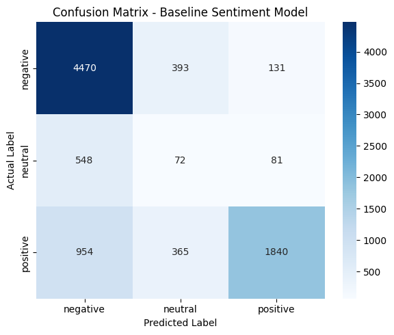
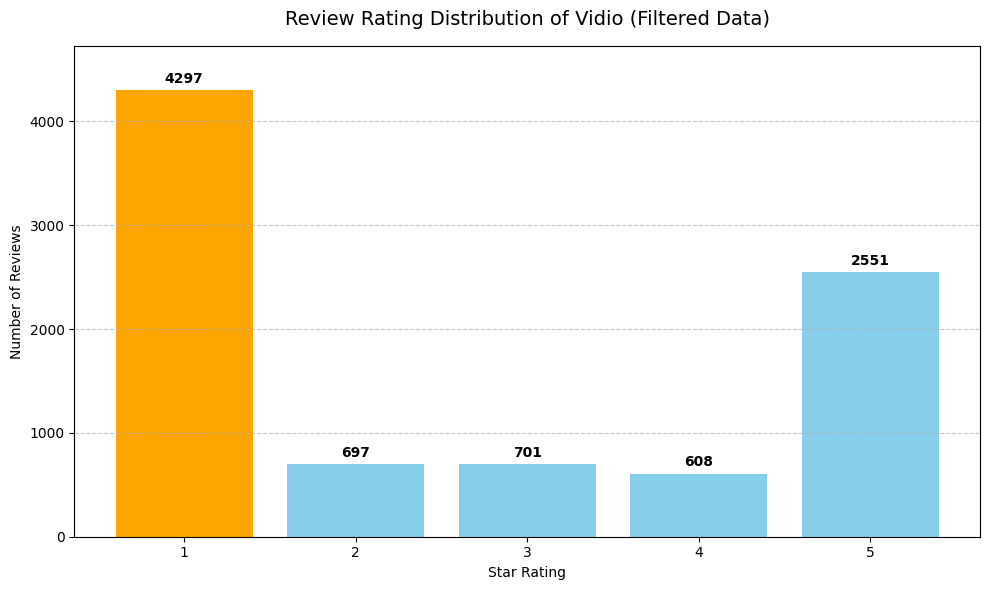
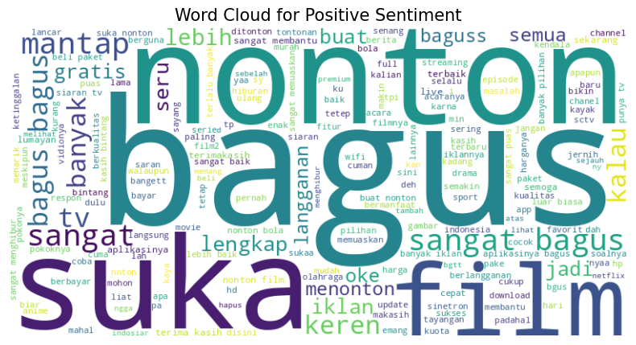
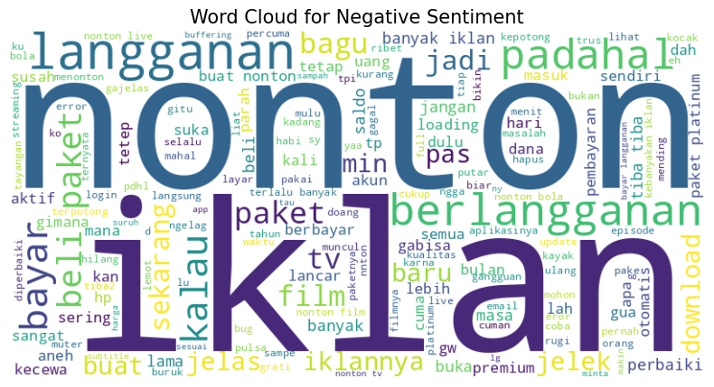

# Topic–Sentiment Analysis of Vidio App Reviews

Integrated analysis of Google Play Store reviews of the Vidio streaming app, combining **BERTopic** (topic modeling) and **IndoRoBERTa** (sentiment classification) to show *which* issues users talk about and *how* they feel about each one.

📄 **Paper:** *An Integrated Topic–Sentiment Analysis of User Reviews in Vidio Application Using BERTopic and IndoRoBERTa*, Journal of Applied Informatics and Computing (JAIC), Vol. 10 No. 3, 2026, pp. 2685–2698.
DOI: [10.30871/jaic.v10i3.12952](https://doi.org/10.30871/jaic.v10i3.12952)

## Problem

App reviews hold useful feedback, but they are numerous, informal, and full of abbreviations and code-mixing, so reading them manually does not scale. Sentiment analysis alone tells you *how* users feel but not *about what*. Topic modeling alone tells you *what* they discuss but not how they feel about it. This project links the two, so each discussion topic gets a sentiment profile that product teams can act on.

## Data

- **Source:** Google Play Store, app ID `com.vidio.android`, Indonesian-language reviews, collected with `google-play-scraper`
- **Period:** 1 April 2025 – 31 March 2026
- **Fields:** review text, star rating, date (no usernames)

| Stage | Reviews |
|---|---|
| Scraped (newest first, limit set to 15,000) | 15,000 |
| Within the study period | 10,602 |
| After removing one-word reviews (final dataset) | **8,854** |

Sentiment labels come from star ratings: 1–2 → negative, 3 → neutral, 4–5 → positive.

| Class | Reviews (rating-based labels) |
|---|---|
| Negative | 4,994 |
| Positive | 3,159 |
| Neutral | 701 |

## Method

1. **Preprocessing:** two separate pipelines
   - *Topic modeling:* case folding, URL removal, slang normalization, repeated-character handling, stopword removal (Sastrawi + domain-specific), bigram/trigram features
   - *Sentiment:* the same normalization steps, with no stemming so that polarity cues are kept
2. **Topic modeling:** BERTopic with `paraphrase-multilingual-MiniLM-L12-v2` embeddings, UMAP (n_neighbors=50, n_components=10), HDBSCAN (min_cluster_size=30, min_samples=10), c-TF-IDF, then topic reduction to 8 clusters (7 topics + outliers)
3. **Sentiment classification:** pre-trained [`w11wo/indonesian-roberta-base-sentiment-classifier`](https://huggingface.co/w11wo/indonesian-roberta-base-sentiment-classifier), applied directly to the reviews (no fine-tuning)
4. **Integration:** each review is linked to its topic and predicted sentiment by a unique review ID
5. **Statistics:** Kruskal–Wallis test for sentiment differences across topics

## Results

**Topic coherence (C_V)** improved from about 0.41 (default BERTopic) to **0.6878** after parameter tuning.

**Sentiment classification** (IndoRoBERTa vs. rating-based labels): accuracy **72%**, weighted F1 **0.7192**.

| Class | Precision | Recall | F1 |
|---|---|---|---|
| Negative | 0.75 | 0.90 | 0.82 |
| Neutral | 0.09 | 0.10 | 0.09 |
| Positive | 0.90 | 0.58 | 0.71 |

**Topics and sentiment** (predicted sentiment):

| Topic | Reviews | Positive | Neutral | Negative |
|---|---|---|---|---|
| 0 – Advertising issues | 3,917 | 685 | 363 | 2,869 |
| 1 – User satisfaction | 1,834 | 780 | 162 | 892 |
| 2 – Film content | 380 | 127 | 38 | 215 |
| 3 – Subscription packages | 245 | 7 | 26 | 212 |
| 4 – Login accessibility | 82 | 0 | 11 | 71 |
| 5 – Interface features | 48 | 2 | 2 | 44 |
| 6 – National TV channels | 37 | 0 | 9 | 28 |
| −1 – Outliers | 2,311 | 451 | 219 | 1,641 |

**Key findings**
- Advertising is the largest topic and about 73% of its reviews are negative.
- Subscription packages, login with phone number, and interface features are also dominated by negative sentiment.
- The satisfaction topic is the only one with a large share of positive reviews, often tied to sports content.
- The Kruskal–Wallis test shows sentiment differs significantly across topics (p < 0.001).

## Figures

| Confusion matrix | Rating distribution |
|---|---|
|  |  |

| Positive reviews | Negative reviews |
|---|---|
|  |  |

## Limitations

- **Class imbalance:** negative reviews dominate, and the model almost never recognizes the neutral class (F1 = 0.09). No resampling or class weighting was applied.
- **Rating-based labels:** star ratings are only a proxy for sentiment and can disagree with the review text.
- **Document-level analysis:** one sentiment per review, so mixed opinions inside a single review are not separated (for example, "good app but missing RCTI channel").
- **Single platform:** Google Play reviews of one app, so results may not generalize to other streaming services.

## Notes on reproducibility

- Google Play returns the newest reviews, so re-scraping gives a different dataset. The raw review data is not included in this repository, so a new run will differ slightly from the numbers reported here.
- The sentiment model is used as-is, without fine-tuning, and evaluated on the full dataset against rating-based labels.
- The default (baseline) BERTopic coherence is 0.4072 in this notebook run and 0.4076 in the paper. Small differences between runs are expected.
- The baseline and tuned models use different topic representations (unigrams vs. bigram/trigram phrases split into words), so their coherence scores are an indicative comparison, not a strict one.
- The paper states a collection window of 2 May 2025 – 2 April 2026. The notebook filter and the data cover 1 April 2025 – 31 March 2026.

## Repository structure

```
├── notebooks/   analysis notebook (Google Colab)
├── images/      result figures
├── requirements.txt
└── README.md
```

## How to run

1. Open the notebook in Google Colab (or Jupyter with a GPU for faster inference).
2. Install dependencies: `pip install -r requirements.txt`
3. Set `BASE_PATH` in the setup cell to a folder you can write to (the notebook uses Google Drive by default).
4. Run the cells in order. Sections: data collection → preprocessing → BERTopic → sentiment → integration → statistics → visualization.

## Tech stack

Python · BERTopic · Sentence-Transformers · Hugging Face Transformers · UMAP · HDBSCAN · Gensim · scikit-learn · SciPy · pandas · matplotlib · seaborn

## Citation

Pinilih, N. W., Dewi, I. N., & Alzami, F. (2026). An Integrated Topic–Sentiment Analysis of User Reviews in Vidio Application Using BERTopic and IndoRoBERTa. *Journal of Applied Informatics and Computing*, 10(3), 2685–2698. https://doi.org/10.30871/jaic.v10i3.12952

## Author

**Nalendra Whisnu Pinilih**
Information Systems graduate, Universitas Dian Nuswantoro · BNSP-certified Associate Data Scientist
[GitHub](https://github.com/nalendra-wp) · nalendrawp@gmail.com

Licensed under the MIT License.
